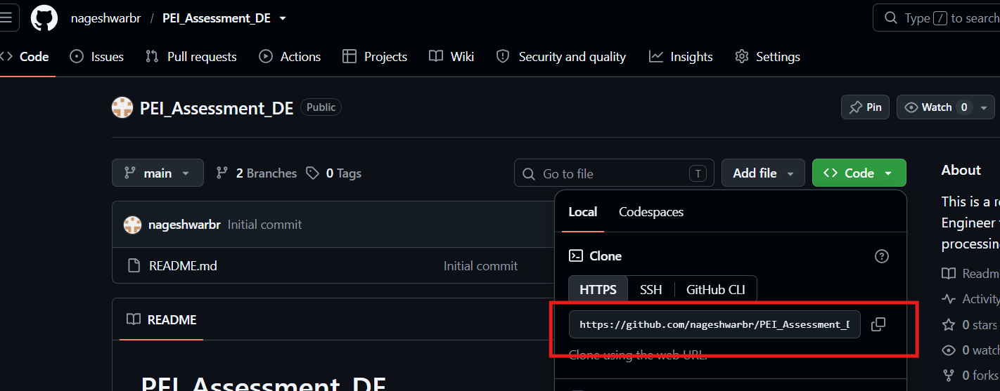
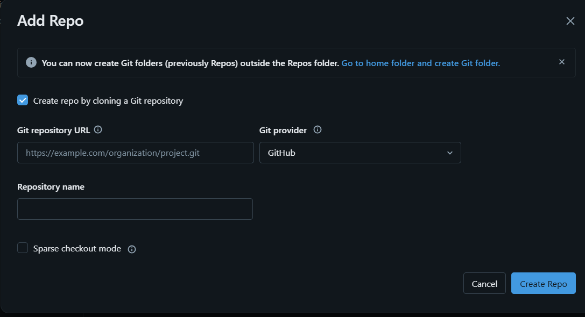
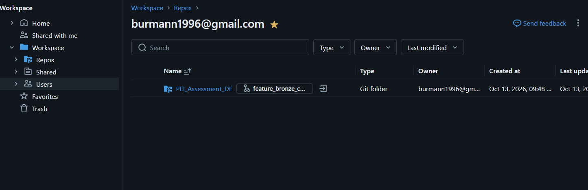
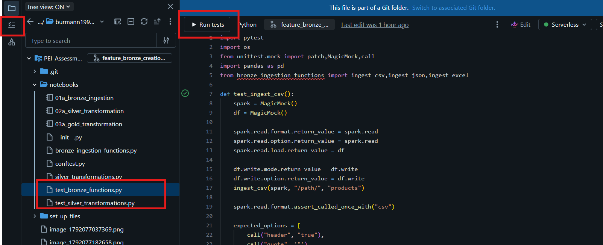
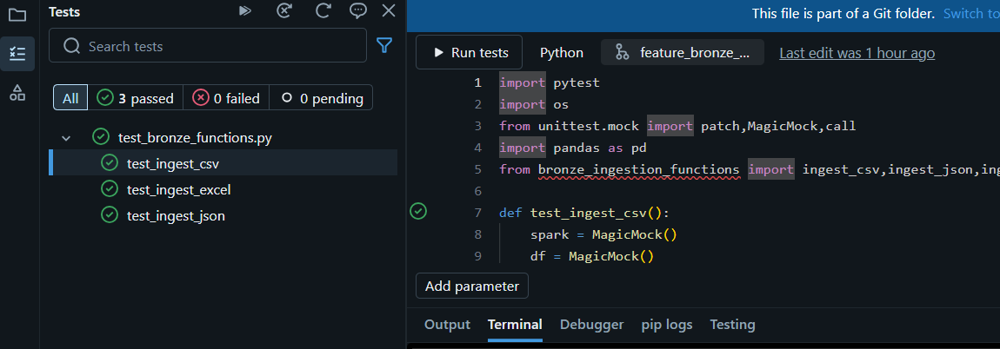

# PEI_Assessment_DE
This is a repo to accomplish Data Engineer task E-commerce sales data processing with Databricks

##Steps to clone from Github:
1. Search with URL: https://github.com/nageshwarbr/PEI_Assessment_DE
2. Copy the link as shown below:

3. Login to Databricks Free Edition.
4. Navigate to Workspace>>Repos>>Create Git Repo
5. Paste copied link in Github repository URL in dialog box. Provide a Repository name. Git Provider is Github.

6. The repository is created as below:

##Catalog, Schema, Table and Volume Creation:
1. Navigate to set_files folder.
2. Run setup_assets starting to end.

##Development Workflow
1. The sequence of running notebooks is 
01a_bronze_ingestion
02a_silver_transformation
03a_gold_transformation

01 defines position,a/b/c is used to define parallel tasks in same position, followed by name for task.
2. Core logic resides in .py files(except conftest and test_* files)
3. .ipynb files are only used to call functions from .py files.
4. For exploratory analysis and development, run notebooks and use for logic development. Later transfer the solidified logic to .py files as functions.

##Unit Testing Setup
1. Testing framework used is pytest.
2. The test files are in red box in notebooks.

3. When you click on any test file you will find a Run Tests button at top that will run all tests in that file.
4. Under Workspace tab is Tests tab that lists all active tests.

5. To run all tests and get coverage report run test_functions notebook in notebooks.
